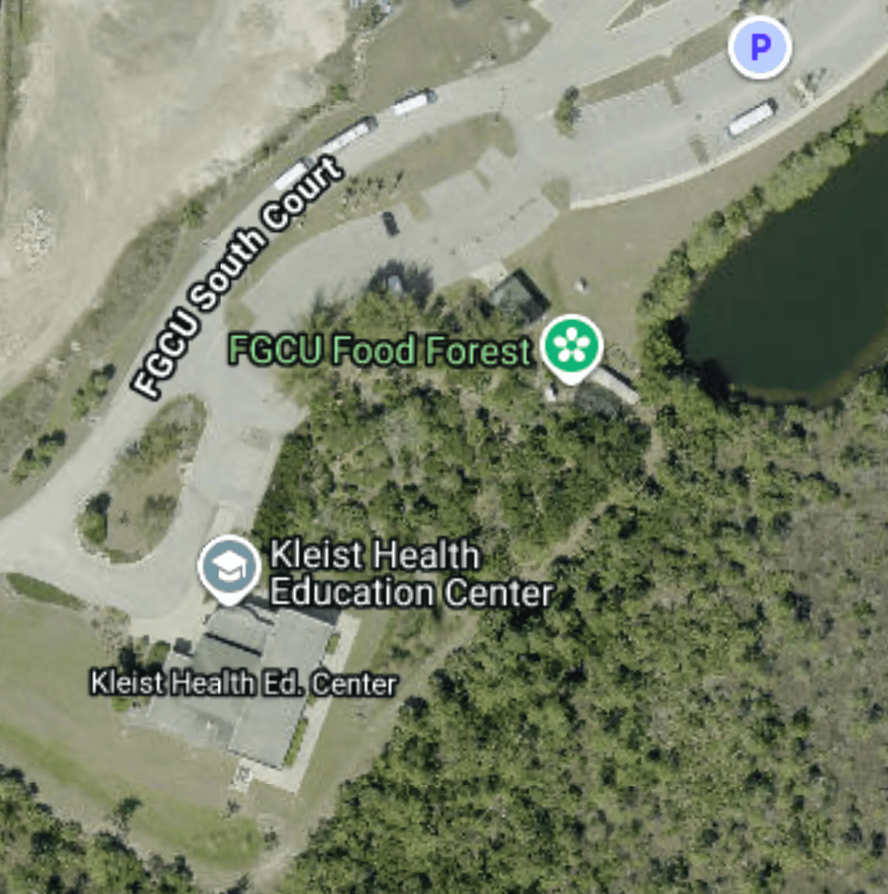
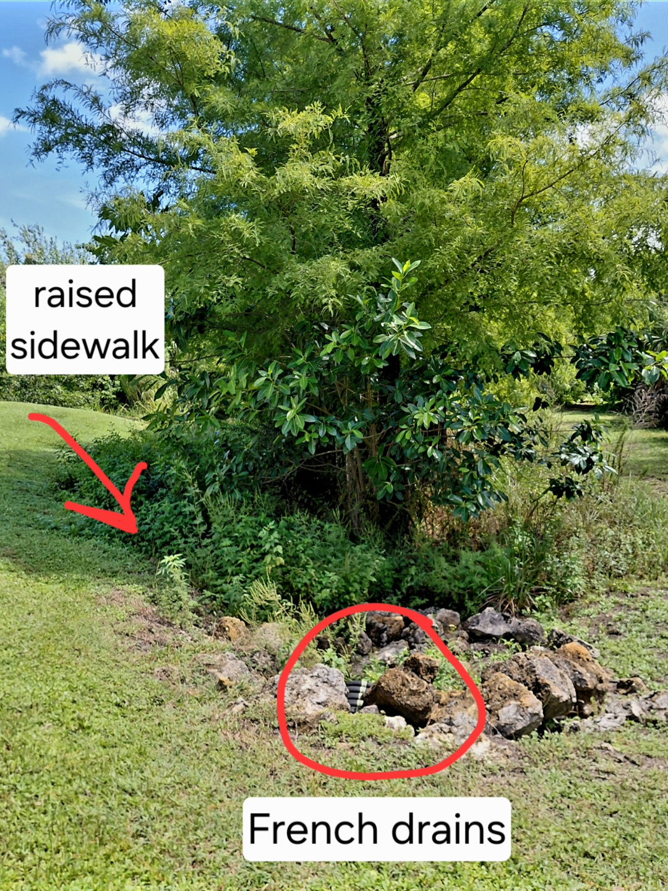
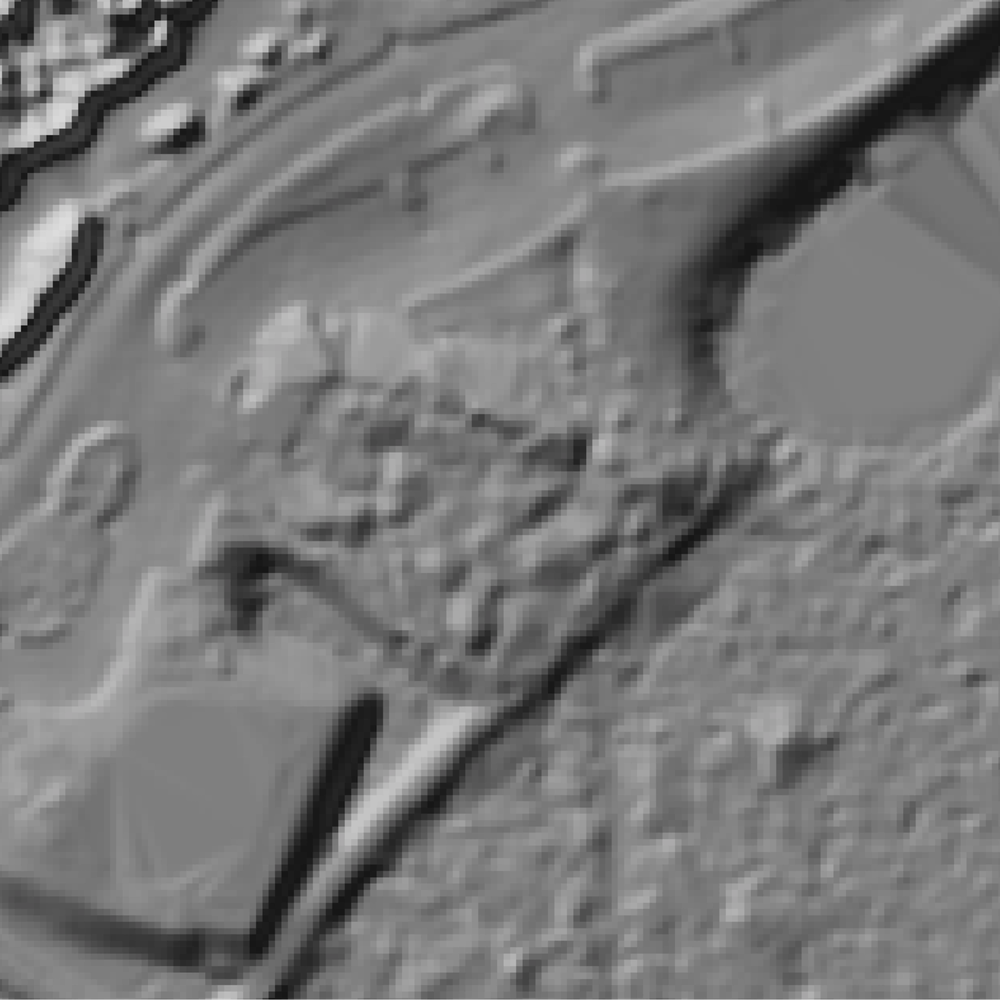
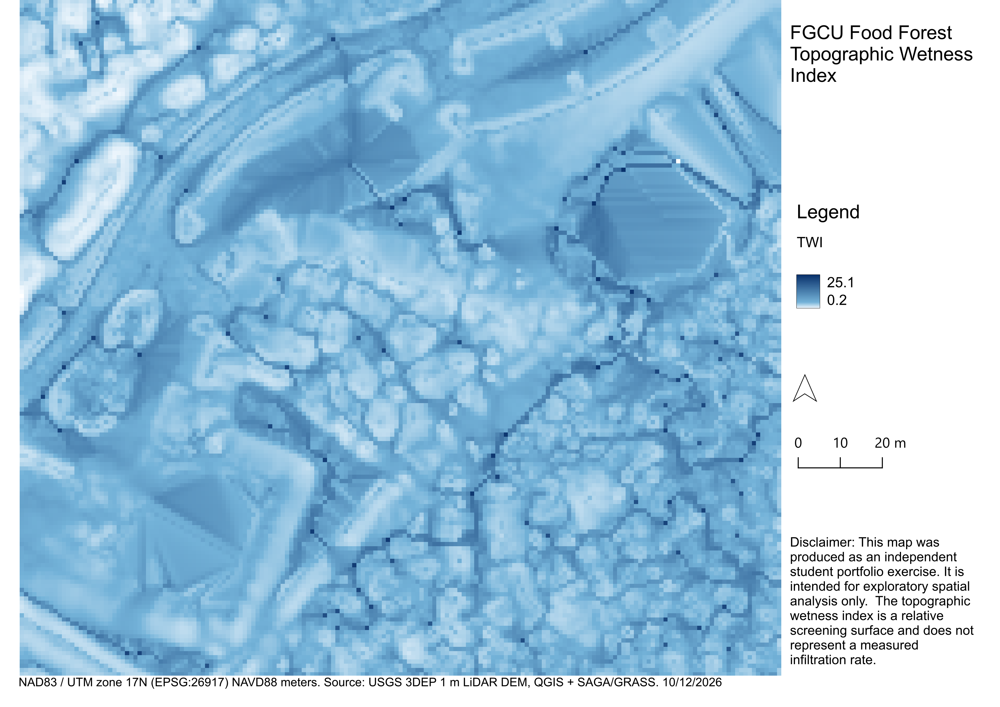
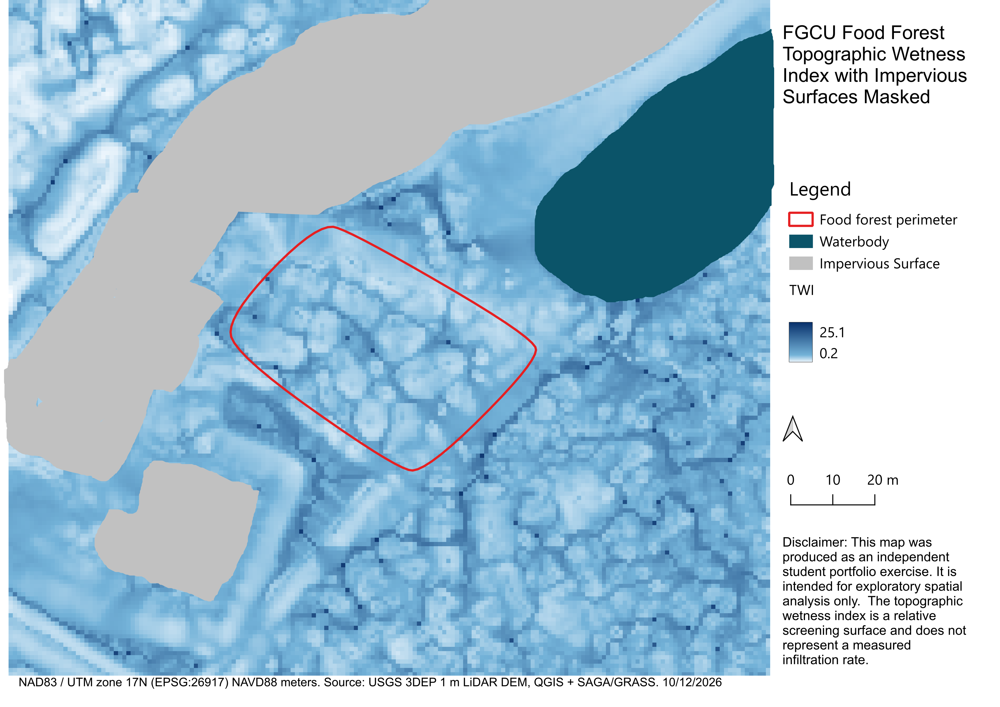

# Lale Califano GIS Portfolio

## About

Welcome to my GIS portfolio! I am an Environmental Geology student at Florida Gulf Coast University exploring the intersection of water systems and landforms. My independent projects focus on hydrologic analysis of water resources and water-related hazards. 

## Featured Projects

### Microtopographic Terrain-Based Analysis of Relative Topographic Wetness Using 1 m LiDAR: FGCU Food Forest
**Tools** QGIS, SAGA/GRASS 

*Map data ©2026 Google.*

### Question
Do the walking paths within the FGCU Food Forest show higher relative topographic wetness than the raised beds the plants are grown on?

### Elevation Data
USGS 3D Elevation Program 1-Meter DEM.

### Soil Data & Limitations
SSURGO Hydrologic Soil Group data was downloaded from the NRCS Web Soil Survey database and found to be uniform throughout the site. The soil is classified as Hydrologic Soil Group A/B, meaning it behaves as group A (high infiltration and low runoff) where undisturbed and group B (moderate infiltration and runoff) where altered. 
Due to limitations in data access, this project was constrained to a terrain-based analysis at this time. A more extensive evaluation of infiltration potential would require integrating soil data such as water table depth, bulk density, and hydraulic conductivity.

### Site Design & Procedure
The FGCU Food Forest was established in 2013 using permaculture design principles. I became interested in this site after observing that the food forest sits at a higher elevation than its immediate surroundings and is bounded by an extensive drainage system and retention basins.

Image showing an example of the French drainage systems surrounding the site.

Because of this elevated setting, the food forest has a highly limited upstream topographic catchment area, meaning standard watershed delineation tools fail. To analyze this landscape, I utilized the Topographic Wetness Index (TWI), which is a steady-state hydrological index that quantifies how topographically flat areas with large upslope contributing zones tend to accumulate water, whereas steep areas drain.

To evaluate the TWI for the FGCU Food Forest, I downloaded a 1-meter USGS 3DEP bare-earth LiDAR Digital Elevation Model (DEM) and reprojected the raster to the EPSG:26917 UTM Zone 17N coordinate system. I created a polygon around the food forest perimeter and generated a 50-meter buffer around it to establish a comparative area with mixed land use. 

Using this clipped DEM, I generated a slope map using the SAGA Slope, Aspect, Curvature tool to calculate the terrain gradients in radians.
 

Slope + hillshade map.

Next, I calculated the TWI by combining the slope derivative with a SAGA Flow Accumulation raster. I observed that the adjacent parking lot, building roof, and water body had misleadingly high wetness indices due to their flat slopes. Because these surfaces are functionally impervious and block infiltration regardless of slope, I created a rough spatial mask to visually isolate these features from the final terrain index analysis.

Initial Topographic Wetness Index map.

Topographic Wetness Index map after masking impervious surfaces. 

### Field Validation & Infrastructure Integration

**Ground-truthing** After a storm, I conducted field validation with my map results to verify that high-value TWI zones accurately correlated with observable surface wetness and soil saturation. I noticed that the soil had a spongier texture, stronger smell, and visibly higher saturation in many of the areas the TWI map identified as having high relative topographic wetness.

**Results**
The analysis identified zones of high wetness and low wetness within the food forest, which might be attributed to the site's permaculture design. However, a map of the walking paths and integration of soil data would be needed to draw any further conclusions. 

**Application**  
This type of limited, terrain-only analysis serves as a quick visual tool to understand how small site features, like footpaths or raised beds, might influence localized surface drainage and wetness patterns.

### Future Projects
My next project will explore the automation of repetitive geospatial tasks using Python. This work will focus on writing scripts to streamline data processing workflows and manage vector or raster datasets more efficiently.

## Portfolio Note

This portfolio is a collection of GIS projects demonstrating my interest in environmental geospatial analysis. I am actively building my skills and looking for internship opportunities where I can contribute to environmental work. 

### Relevant Coursework

- Introductory ArcGIS
- Hydrogeology
- Introductory Hydrology
- Soil and Water Science
- Coastal & Watershed Geology

## Contact

Email: tcalifano8127@eagle.fgcu.edu  
GitHub: https://laira-gis.github.io/portfolio/
