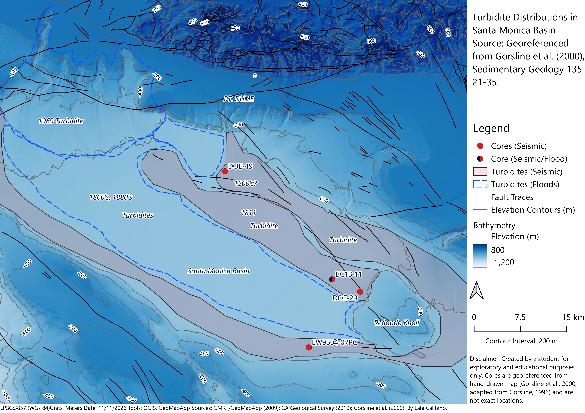
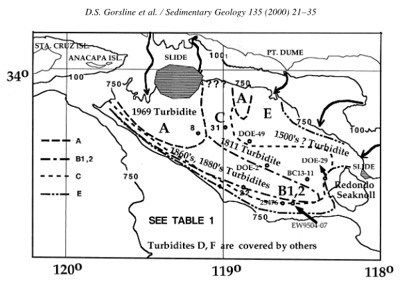

#  Georeferencing Historical Marine Map: Santa Monica Basin Turbidites
Published: 11/22/2026

<em>The modernized GIS map, featuring cartographic generalization, hillshade, and fault traces to clearly visually separate flood versus seismic deposits.</em>
  

## Tools
GeoMapApp; QGIS. 

## Data 
Global Multi-Resolution Topography (GMRT) Synthesis (via GeoMapApp)   
Fault Traces (California Geological Survey)

## Question
What would this hand-drawn map displaying the areal extent of turbidite deposits in the Santa Monica Basin look like if reconstructed using modern GIS technology?  

<em>Original hand-drawn map showing overlapping turbidite distributions (Gorsline, 1996).</em>

## Project Context and Objectives

For a marine geology presentation on turbidites I read a paper titled "Seismically Triggered Turbidites in Small Margin Basins" published in 2000 by Gorsline et al. Seeing this hand-drawn, difficult to read map I became curious as to how it might look if created today. Turbidites are gravity-slope driven sedimentary deposits formed by turbidity currents, underwater sediment-laden water moving rapidly down continental slope or submarine canyons. 

This paper explained that in the tectonically active Santa Monica Basin, these flows are triggered by both coastal river floods and seismic events that induce submarine slope failure. The objective of this map was to visually communicate the distinct differences between these two triggering events. According to the geochronological data presented in the Gorsline et al. (2000) study, flood-triggered turbidites occur at more frequent rates but are relatively small in volume. Seismically triggered turbidites to occur at centennial intervals but are significantly larger. The GIS map was designed to visually separate these two distinct deposits, how they overlap, and where cores were extracted. 

## Methodology and Data Sources

To digitize a low-resolution, 1990s map the first step was georeferencing the original Figure 4 from the Gorsline paper. I utilized two prominent and stable geographic features to be control points, Point Dume to the north and Redondo Knoll to the southeast. These features were chosen because they are distinct, recognizable geological landmarks present on both the historical map and modern bathymetric basemaps.

The most significant challenge I encountered was digitizing polygons to accurately cover the turbidite boundaries. The original 1996 map utilized overlapping dashed and dotted lines to represent multiple depositional events, which made the figure difficult to interpret. Attempting to precisely trace the overlapping lines resulted in an unreadable map. For this reason, I chose the method of cartographic generalization to present spatial extent, age and trigger types into readable zones. 

<em>The data table used to categorize the turbidites by volume, area, and trigger type.</em>

By cross-referencing the spatial extents with Table 1 from the research paper, which details the age, area, volume, and trigger type of each deposit, I generalized the complex overlapping lines into two distinct, readable zones. These zones represent broad areas of Flood Turbidites (outlined in blue) and Seismic Turbidites (represented by a light red polygon). This choice prioritizes the communication of the geological trigger mechanism over the precise, overlapping boundaries of individual historical events, making the data accessible to a broader audience.

## Cartographic Choices

To provide geological context, map layers included a bathymetric basemap with hillshade added to better visualize the relief of the submarine canyons and basin floor. Elevation lines, placed every 200 meters, were included to provide the depth profile. These elevation contours generally align with the historical map.  Fault traces were added as a layer to highlight the tectonic setting, which reinforced the paper's explanation that seismic events are a trigger for these mass-wasting deposits. Finally, the specific locations of the sediment cores, such as DOE-49 and EW9504-07PC, were plotted, as these cores are the direct source of the stratigraphic and chronological data used in the study.

## References

Gorsline, D.S., De Diego, T., and Nava-Sanchez, E.H. (2000). Seismically triggered turbidites in small margin basins: Alfonso Basin, Western Gulf of California and Santa Monica Basin, California Borderland. *Sedimentary Geology*, 135(1–4), 21–35.

Ryan, W. B. F., Carbotte, S. M., Coplan, J. O., O'Hara, S., Melkonian, A., Arko, R., Weissel, R. A., Ferrini, V., Goodwillie, A., Nitsche, F., Bonczkowski, J., & Zemsky, R. (2009). Global Multi-Resolution Topography synthesis. Geochemistry, Geophysics, Geosystems, 10(3), Q03014.

Jennings, C. W., & Bryant, W. A. (2010). Fault Activity Map of California (Geologic Data Map No. 6, Version 2.0, scale 1:750,000) [Dataset]. California Geological Survey, California Department of Conservation. https://maps.conservation.ca.gov/cgs/fam/
