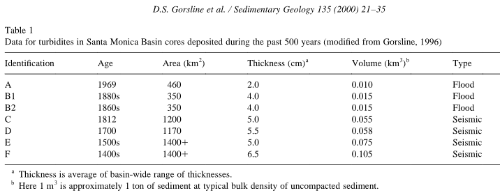

# Modernizing Historical Marine Geology Data: A GIS Reconstruction of Santa Monica Basin Turbidites

## Project Context and Objectives

This project was developed for a marine geology presentation focused on the spatial distribution and triggering mechanisms of submarine sediment flows. While reviewing the foundational research by Gorsline et al. (2000) regarding seismically triggered turbidites in the California Borderland, I encountered the original hand-drawn map detailing the areal extent of these deposits over the past 500 years. Reading the paper prompted a research question: what would this historical data look like if reconstructed using modern GIS technology? This project represents the application of modern geospatial tools to historical geological data, demonstrating how contemporary cartography can clarify complex spatial relationships that were previously difficult to visualize.

## Geological Background

Turbidites are the sedimentary deposits formed by turbidity currents, which are rapid, waning sediment-gravity flows that travel down submarine slopes. In the tectonically active Santa Monica Basin, these flows are triggered by two primary mechanisms: exceptional coastal river floods and seismic events that induce submarine slope failure. The objective of this map was to visually communicate the distinct differences between these two triggering mechanisms. According to the geochronology and volumetric data presented in the Gorsline et al. (2000) study, flood-triggered turbidites occur at more frequent intervals but are relatively small in volume. In contrast, seismically triggered turbidites occur at centennial intervals but are significantly larger. The data indicates that flood turbidites are typically about 1/5 the size of seismic turbidites, which cover up to twice the basin floor area. The GIS map was designed to clearly delineate these two distinct spatial footprints to illustrate this geological principle.

## Methodology and Data Sources

The reconstruction process required several applied geospatial techniques to translate a low-resolution, 1990s raster image into an accurate, modern spatial model. The first step was georeferencing the original Figure 4 from the Gorsline paper. To align the historical image with real-world coordinates, I utilized two prominent, stable geographic features as control points: Point Dume to the north and Redondo Knoll to the southeast. These features were chosen because they are distinct, recognizable geological landmarks present on both the historical map and modern bathymetric basemaps, ensuring the image could be stretched and rotated accurately without distortion.

The most significant challenge was digitizing the turbidite boundaries. The original 1996 map utilized overlapping dashed and dotted lines to represent multiple depositional events, which made the figure visually cluttered and difficult to interpret. Attempting to precisely trace every overlapping line would have resulted in an unreadable map. To resolve this, I applied the cartographic principle of generalization. By cross-referencing the spatial extents with Table 1 from the research paper, which details the age, area, volume, and trigger type of each deposit, I generalized the complex overlapping lines into two distinct, readable zones. These zones represent broad areas of Flood Turbidites (outlined in blue) and Seismic Turbidites (represented by a grey polygon). This choice prioritizes the communication of the geological trigger mechanism over the precise, overlapping boundaries of individual historical events, making the data accessible to a broader audience.

## Cartographic Choices

To provide necessary geological context, several modern layers were integrated into the map. A high-resolution bathymetric basemap with hillshade was added to replace the original blank background, illustrating the true three-dimensional relief of the submarine canyons and basin floor. Elevation contour lines, spaced every 200 meters, were included to visualize the depth profile of the basin. Furthermore, fault traces were added as a layer to highlight the tectonic framework of the region, visually reinforcing the paper's explanation of why seismic events are a primary trigger for mass wasting in this basin. Finally, the specific locations of the sediment cores, such as DOE-49 and EW9504-07PC, were plotted, as these cores are the direct source of the stratigraphic and chronological data used in the study.

## Visual Comparison

The original hand-drawn map from 1996 relied on overlapping dashed lines that obscured the relationship between the flood and seismic deposits. The modernized GIS map replaces these lines with clear polygons and integrates modern bathymetry to provide immediate visual context for the geological processes at work.

<em>Original hand-drawn map showing overlapping turbidite distributions (Gorsline, 1996).</em>

<em>The data table used to categorize the turbidites by volume, area, and trigger type.</em>

<em>The modernized GIS map, featuring cartographic generalization, hillshade, and fault traces to clearly delineate flood versus seismic deposits.</em>

## Applied Geological and Geospatial Skills

This project demonstrates the practical application of both geological knowledge and geospatial technology. From a geological perspective, this project required the interpretation of scientific literature to understand the stratigraphic record of turbidites, the ability to differentiate between flood and seismic trigger mechanisms based on volumetric data, and an understanding of the tectonic framework of the California Continental Borderland. From a geospatial perspective, the project required proficiency in georeferencing historical raster data using stable geological control points, applying cartographic generalization to simplify complex overlapping data, integrating tabular data into spatial features, and designing a professional map layout with appropriate legends, scale bars, and metadata. By combining these skills, this project transforms a complex historical figure into a functional, scientifically accurate visual model suitable for modern geological analysis.

## References

Gorsline, D.S., De Diego, T., and Nava-Sanchez, E.H. (2000). Seismically triggered turbidites in small margin basins: Alfonso Basin, Western Gulf of California and Santa Monica Basin, California Borderland. *Sedimentary Geology*, 135(1–4), 21–35.
